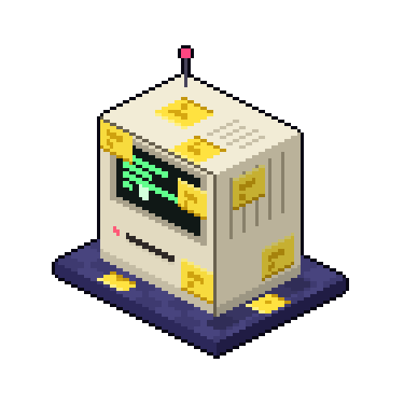
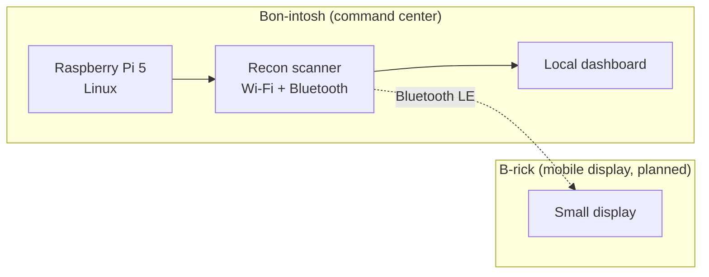

# Bon-intosh
Retro-futuristic cyberdeck built on a Raspberry Pi 5. Hardware build, Linux setup, and base configuration for a portable network-recon command center. Companion to the B-rick.


<p align="center">
  
</p>

<h1 align="center">BON-INTOSH</h1>

```
MOBILE SECURITY ANALYST
NETWORK RECONNAISSANCE ENGINE
DISTRIBUTED THREAT ASSESSMENT
PORTABLE EMBEDDED CYBERSECURITY LAB
```

<p align="center">
  
  
  
  
</p>

<p align="center">
  
</p>

    
<!-- TODO: one good photo of the finished  / thinking of a turnaround gif/ (or in-progress) build -->

A portable, retro-styled cyberdeck built around a Raspberry Pi 5 inside a Macintosh-style case. **Bon-intosh** is the home-base command center for wireless and network reconnaissance. **B-rick**, a planned DynaTAC-style companion device, will act as a mobile display that receives scan data over Bluetooth.

Built by Bon Varlet as a hands-on project in embedded systems and security tooling.

> **Status:** Under construction. Hardware is being assembled and no software has shipped yet. The roadmap below shows what works and what doesn't.

---
**The [B-Together Project](https://github.com/BA-Varlet/BA-Varlet):**
- **Bon-intosh**(This Repo): the command center (hardware, setup, and base configuration)
- [B-rick](https://github.com/BA-Varlet/B-rick/): the mobile companion
- [B.O.N. Software](https://github.com/BA-Varlet/BON-Software): the security tools and scripts that run on both
---
## Why I'm building this

I wanted a project that forces me to touch the whole stack: hardware assembly, Linux configuration, wireless protocols, my own tooling, and a two-device design. The retro aesthetic is for fun. The engineering is the point.

## System overview



| Device | Role | Status |
|---|---|---|
| **Bon-intosh** | Command center: runs the scanner and dashboard | Building |
| **B-rick** | Mobile display: receives scan data over Bluetooth | Planned |

## Hardware: Bon-intosh

| Part | Notes |
|---|---|
| Raspberry Pi 5 | Built-in Wi-Fi (802.11ac) and Bluetooth 5.0 |
| Macintosh-style case | Design by [BrentTechLLC](https://www.etsy.com/shop/BrentTechLLC?ref=shop-header-name&listing_id=4398277635&from_page=listing)|
| Display | [EYOYO / 8 in] |
| Raspberry Pi 5 Active Cooler | The case is enclosed, so I'm using active cooling to avoid thermal throttling |
| microSD card | [128 GB] |
| Keyboard and mouse | [None Yet] |

**Software:** [LINUX]

## Planned first tool: Recon Scanner

The first program I'm writing for the deck is a scanner that:

1. Lists nearby Wi-Fi networks with signal strength, channel, and encryption type
2. Enumerates nearby Bluetooth devices
3. Shows the results on a local dashboard
4. Sends results to B-rick over Bluetooth later

Planned stack: Python 3, with a lightweight web dashboard and standard Linux wireless tooling. Anything needing monitor mode, like packet capture, will likely require an external USB Wi-Fi adapter. That is a later add-on, not part of version 1.

<!-- When it works, add:  and  -->

## Roadmap

- [x] Concept, naming, and branding
- [x] Parts list finalized
- [ ] Assemble Bon-intosh and boot it
- [ ] Configure OS, display, and cooling
- [ ] Wi-Fi scanner (CLI)
- [ ] Bluetooth scanner (CLI)
- [ ] Local dashboard
- [ ] Build B-rick
- [ ] Bluetooth data link between Bon-intosh and B-rick
- [ ] Write-up of lessons learned

## Build log

| Date | Update |
|---|---|
| [9/20/2026] | Parts ordered, project started |
| [10/20/2026] | [Bon-intosh assembly commencement] |

<!-- Add one line per milestone as project moves -->

## Responsible use

This project is for learning and for testing networks and devices that I own or have explicit permission to assess. Scanning or attacking systems without authorization is illegal and unethical.

## What I'm learning

- [[Pi 5 thermal behavior in an enclosed case, how Wi-Fi scanning works at the OS level, BLE basics, Hardware-software intergration]]

## License

[MIT]

Case design is by [BrentTechLLC] and is subject to their license.
